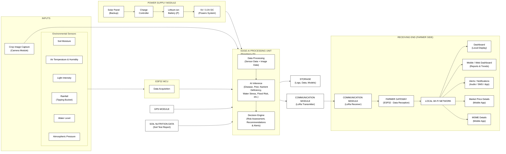

# FARMAXPERT

### AI-Powered Predictive Agronomy and Market Linkage from Planting to Profit

FARMAXPERT is a hardware-led, AI-powered smart farming assistant that supports a farmer through the whole crop cycle, from field monitoring and crop care to harvest and selling. A solar-powered field unit senses the soil and the crop, an on-device AI model detects diseases and pests, and a mobile/web application turns the data into simple advice, shows nearby market prices and connects farmers with MSME buyers. The core of the system keeps working even when there is no internet.

---

## Table of Contents

1. [The Problem](#the-problem)
2. [Our Solution](#our-solution)
3. [Key Features](#key-features)
4. [System Architecture](#system-architecture)
5. [Hardware Components](#hardware-components)
6. [Software Stack](#software-stack)
7. [How It Works in the Field: Banana Farm Example](#how-it-works-in-the-field-banana-farm-example)
8. [Comparison with Existing Solutions](#comparison-with-existing-solutions)
9. [What Makes FARMAXPERT Different](#what-makes-farmaxpert-different)
10. [Current Status](#current-status)
11. [Estimated Impact and ROI](#estimated-impact-and-roi)
12. [Implementation Roadmap](#implementation-roadmap)
13. [Risks and Mitigation](#risks-and-mitigation)
14. [Potential Partners and Adoption](#potential-partners-and-adoption)
15. [Team](#team)
16. [References](#references)

---

## The Problem

Small farmers face many problems at the same time, and most decisions about watering, spraying, harvesting and selling are taken with late or incomplete information.

- In Tamil Nadu, small and marginal farmers are about **93%** of all agricultural landholders (*Highlights for the Year 2024-2025*).
- Agriculture uses over **90%** of the state's groundwater, and about **34%** of groundwater blocks are overexploited (*Central Ground Water Authority report*).
- Land plots are small and scattered, so checking every plant on foot is slow, tiring and expensive.

We group the recurring problems into seven areas:

| No. | Problem | Impact on the farmer |
|---|---|---|
| 1 | Water scarcity and wasteful irrigation | Water is wasted in some places while plants dry out in others. |
| 2 | Weather and climate risk | Heat waves, heavy rain, floods and drought damage the crop at important stages. |
| 3 | Diseases, pests and nutrient deficiency | Problems are noticed only after damage is visible, so the loss is already large. |
| 4 | Soil health problems | Wrong or excess fertiliser degrades the soil over the years. |
| 5 | Unstable income and poor market information | Prices change daily and the farmer does not know which market pays more. |
| 6 | High cost and labour shortage | Walking the field repeatedly costs time, money and workers. |
| 7 | Post-harvest loss and no buyer | Produce spoils or stays unsold because of bad timing, weather or lack of a buyer. |

## Our Solution

FARMAXPERT works in four simple steps:

1. **Collect** field data with a camera and environmental sensors.
2. **Think** using AI running on the device (Edge AI).
3. **Advise** the farmer through a dashboard, mobile/web app and alerts.
4. **Sell** with the help of market-price comparison and an MSME buyer marketplace.

## Key Features

| Feature | What it does |
|---|---|
| **AI disease and pest detection** | A camera captures leaf images and a YOLO model identifies the disease or pest, estimates severity (low, medium, high) and suggests precautions. |
| **Smart irrigation** | Soil-moisture sensors show which part of the field needs water. Pumps and valves can be connected for automatic, zone-specific watering. |
| **Climate risk alerts** | Local sensor data is cross-checked with the IMD weather forecast to warn about heat, drought, heavy rain and flood risk. |
| **Soil nutrition advice** | Lab soil-test results are added to the farm profile; the system finds low nutrients and suggests suitable fertiliser for the crop and its growth stage. |
| **Zone-wise monitoring** | A farm is divided into about four to five zones, so decisions are targeted instead of applied to the whole farm. |
| **Predictive harvest alerts** | Crop maturity and weather forecast are combined, so the farmer is told whether to harvest early or keep monitoring. It never recommends early harvest on the forecast alone. |
| **Market price comparison** | Prices from nearby markets (e-NAM and AGMARKNET) are shown with date and source, clearly marked as reported prices, not guaranteed prices. |
| **Farmer-to-MSME marketplace** | Farmers list produce; MSMEs list requirements; the app matches the two. |
| **FarmExpert app** | Keeps farm profile, crop history, input records, harvest and loss records in one place and shows advice in simple language. |
| **Works offline** | Sensing, AI detection and local alerts run without internet. Internet is only needed for weather and market data, and data syncs later. |

## System Architecture

**Block summary**

- **Inputs:** crop images, soil moisture, air temperature and humidity, light intensity, rainfall, water level, air pressure, GPS location, registered farm and crop details, and soil-test data.
- **Processing:** the ESP32 collects sensor readings and passes them to the Raspberry Pi 5, which runs the YOLO model and the decision engine. Logs, data and models are stored on the device.
- **Communication:** LoRa carries results from the field unit to a gateway on the farmer side, which passes them to the local Wi-Fi network.
- **Outputs:** local dashboard, mobile/web app and alerts (audio, SMS, app). The app also shows market prices and MSME buyer details.
- **Power:** a solar panel charges a lithium-ion battery through a charge controller; a 5 V / 3.3 V supply powers the system.

The same core intelligence is designed to be modular, so it can be packaged as a fixed **Scout** unit, a **Rover**, or a **Drone**, depending on the farm.

## Hardware Components

| Part | Component | Job |
|---|---|---|
| Edge AI unit | Raspberry Pi 5 + AI accelerator | Runs the AI model and decision logic |
| Microcontroller | ESP32-WROOM-32 | Collects sensor data |
| Camera | Raspberry Pi Camera Module 3 (12 MP, autofocus) | Captures crop and leaf images |
| Air temperature and humidity | Sensirion SHT31-D | Measures weather in the field |
| Soil moisture | DFRobot SEN0193 capacitive sensor | Measures soil wetness |
| Rainfall | Tipping-bucket rain gauge | Measures rain |
| Light intensity | BH1750 | Measures sunlight |
| Water level | DFRobot A02YYUW ultrasonic / SEN0257 pressure sensor | Measures water level |
| Location | GPS module | Gives farm location |
| Communication | LoRa transmitter and receiver, farmer-side ESP32 gateway | Sends data from field to farmer |
| Power | Solar panel, charge controller, Li-ion battery | Powers the system |

## Software Stack

| Area | Tools | Use |
|---|---|---|
| AI / ML | Python, YOLO (Ultralytics) | Disease and pest detection |
| Image processing | OpenCV, Pillow, NumPy | Cleaning and preparing images |
| Backend | FastAPI, REST APIs | Connects device, records and app |
| Frontend | React | Farmer web and mobile interface |
| External data | IMD Weather API, e-NAM, AGMARKNET | Weather and market prices |
| Development | VS Code, Git | Coding and version control |

**Tech flow:** image capture → OpenCV / Pillow processing → YOLO detection → Python edge logic → FastAPI backend → REST API → React farmer interface.

## How It Works in the Field: Banana Farm Example

To show the full chain, we follow a **2-acre banana farm in Tamil Nadu**. Banana takes about 10 to 12 months to grow, so a single crop cycle meets all seven problems.

| Problem | What FARMAXPERT does |
|---|---|
| Water scarcity | Checks moisture in different zones and waters only where needed. |
| Weather risk | Warns in advance of heat at flowering, heavy rain and strong wind using sensors and the forecast. |
| Disease and pests | The camera and YOLO model catch leaf spots early. The banana model is built and still under testing. |
| Soil health | Uses the lab soil-test report for nutrients and salinity, because basic sensors cannot measure them reliably. |
| Market information | Shows prices in nearby markets in the same app before the bunches are sold. |
| Labour and cost | Points to the zones that need a visit instead of inspecting every plant daily. |
| Post-harvest loss | Checks how ripe the crop is and how reliable and serious the forecast is before advising on harvest timing. |

## Comparison with Existing Solutions

Each existing service solves one part of the problem. FARMAXPERT is designed to cover the whole chain, from field sensing to buyer.

| Feature | KVK / Uzhavan App | KissanAI | Plantix | Fasal / Cropin | eNAM / Agmarknet | **FARMAXPERT** |
|---|:---:|:---:|:---:|:---:|:---:|:---:|
| Early disease and pest detection | Slow | Partly | Yes | Partly | No | **Yes** |
| Works without internet in the field | Yes | No | Partly | No | No | **Yes** |
| Uses images, sensors, weather and history together | No | No | No | Partly | No | **Yes** |
| Irrigation advice | Partly | Partly | No | Yes | No | **Yes** |
| Fertiliser advice from soil-test report | Partly | Partly | No | Partly | No | **Yes** |
| Harvest alerts using crop maturity and forecast | No | Partly | No | Partly | No | **Yes** |
| Market price comparison | Partly | Partly | No | No | Yes | **Yes** |
| Farmer-to-MSME buyer matching | No | No | No | No | Partly | **Yes** |
| **Features fully covered (out of 8)** | 1 | 0 | 1 | 1 | 1 | **8** |

> This is our own comparison based on the publicly described features of each service. Features may change as these services are updated.

## What Makes FARMAXPERT Different

1. **Edge and cloud together.** The device does the important work in the field without internet, so alerts are quick. The cloud is used for history, model improvement and deeper analysis when connectivity is available.
2. **Many data sources together.** Crop images, soil and weather readings, crop stage, farm history and soil-test results are combined before advice is given, not just a single photo.
3. **Advice for your own farm.** Recommendations depend on the farmer's location, crop, zone, growth stage and local climate.
4. **Zone-wise farm intelligence.** Each zone of a farm is monitored separately, so decisions are targeted.
5. **From crop problem to harvest to buyer.** The system does not stop at finding a disease. It also advises on harvest timing, compares prices and helps find a buyer.

## Current Status

**FARMAXPERT is at the prototype stage.** The software and AI components are built, and the hardware is being integrated. The system has not yet been field-validated.

**Completed**

- Separate YOLO models for **tomato** and **banana** disease and pest detection.
- Models trained on online datasets plus our own leaf photos taken in real conditions.
- Tomato detection tested with a live camera; banana model tested on fresh leaves in the field.
- Web dashboard showing disease severity (low, medium, high), precautions and fertiliser suggestions.
- Sample sensor readings and the alert workflow tested on the dashboard.
- Tamil language support for the tomato model; both models available in English.

**In progress / next**

- Complete hardware-software integration.
- Controlled testing, then field validation on selected crops and farms.
- More testing of the models on other crops, regions and weather conditions.

## Estimated Impact and ROI

> These are planning estimates, not proven results. The benefit percentages are targets that will be checked in field trials before any claim is made.

Example: a 2-acre banana farm, assuming about 25 tonnes per acre and a farm-gate price of about Rs 12 per kg (crop value about Rs 6,00,000).

| Benefit | Basis | Value per year |
|---|---|---|
| Disease loss avoided | About 3% of crop value | Rs 18,000 |
| Less harvest and post-harvest loss | About 2% of crop value | Rs 12,000 |
| Better selling price | About Rs 0.50 more per kg on 50 tonnes | Rs 25,000 |
| Fertiliser saving | About 15% of Rs 60,000 | Rs 9,000 |
| Water and power saving | Watering only where needed | Rs 6,000 |
| Labour saving | Fewer full-field inspections | Rs 8,000 |
| **Total** | | **about Rs 78,000** |

Prototype cost is about Rs 45,000 to 55,000, with a target of Rs 35,000 to 40,000 at scale and a yearly running cost of about Rs 2,000 to 5,000.

| Scenario | Net benefit per year | Payback time |
|---|---|---|
| Base case (full benefits, Rs 40,000 unit) | about Rs 74,500 | about 6.5 months |
| Conservative case (half the benefits) | about Rs 35,500 | about 13.5 months |
| Prototype cost (Rs 55,000 unit, base benefits) | about Rs 74,500 | about 9 months |

Over a 5-year life the system costs about Rs 11,500 per year, roughly 2% of this farm's crop value, so a small improvement in yield or income is enough to pay for it. Cost per farmer falls further when a Farmer Producer Organisation (FPO) or cooperative shares a unit.

## Implementation Roadmap

| Phase | What we will do | How we will check |
|---|---|---|
| 1. Prototype integration | Connect camera, ESP32 sensors, Raspberry Pi, LoRa and alerts into one working unit. | Data flows from sensor to app |
| 2. Crop and field testing | Test on selected crops and farms with feedback from agriculture experts. | Detection accuracy, sensor reliability, offline working |
| 3. Field pilot | Give the app and device to a few farmers and observe use. | Ease of use, reliability, real benefits |
| 4. Market and expansion | Connect e-NAM and AGMARKNET prices and MSME matching, then grow through FPOs, KVKs and cooperatives. | Farmer feedback, cost per unit, number of users |

We will expand only after accuracy, reliability and cost are proven, and we will not assume that results for one crop or region hold for another.

## Risks and Mitigation

| Risk | Our plan |
|---|---|
| Power failure | Solar panel with battery backup. |
| Too much load on one processor | ESP32 handles sensors; Raspberry Pi handles AI. |
| Farmer finds it hard to use | Simple alerts that say what the risk is, where it is and what to do; Tamil support. |
| Sensor drift | Regular calibration and data validation. |
| Model works only on some crops | Crop- and region-specific models, with field validation before making claims. |
| Wrong price information | Always show source and date, and state that it is a reported price, not guaranteed. |

## Potential Partners and Adoption

Ministry of Agriculture and Farmers Welfare, Tamil Nadu Department of Agriculture, RKVY-RAFTAAR incubation centres, TNAU and ICAR institutions, Krishi Vigyan Kendras (KVKs), Farmer Producer Organisations, cooperatives and agritech companies. Actual adoption depends on their interest and approval.

**Support we are looking for:** seed funding or grants for hardware, model development and field trials; partnerships with sensor makers, agritech companies and farming communities; mentoring in AI, embedded systems, precision agriculture and agribusiness; and help finding pilot farms and moving towards an affordable product.

## References

1. Dr. Vimal Jothi I., Senior Agricultural Officer, Fertilizer Control Laboratory, Department of Agriculture, Government of Tamil Nadu. Agricultural domain expert consultation and guidance.
2. Tamil Nadu Agricultural University (TNAU), "Pest Analysis and Pesticide Recommendations," TNAU Agritech Portal, Coimbatore, India.
3. U.S. Environmental Protection Agency (EPA), "International Activities Related to Pesticides," Washington, DC, USA.
4. A. J. Atapattu, S. Udumann and N. S. Dissanayaka, "Challenges in Achieving Artificial Intelligence in Agriculture," in *Artificial Intelligence Techniques in Smart Agriculture*, Springer Nature Singapore, 2024, pp. 7-34, doi: 10.1007/978-981-97-5878-4_2.
5. A. Agata and D. Pramesti, "An AI-Driven Mobile Farmer Assistant for Agricultural Information," 2025 IEEE International Conference, pp. 1-6, doi: 10.1109/ICISS66954.2025.11389293.
6. S. Salian and R. Dsouza, "Smart Farming Assistant for Crop Advice and Disease Detection," 2025 IEEE International Conference, pp. 1-6, doi: 10.1109/DISCOVER66922.2025.11259034.
7. PlantVillage / Figshare, "PlantVillage Dataset: Plant Disease Diagnostic Image Dataset," Figshare, 2025.
8. A. H. A. Hussein, K. A. Jabbar, A. Mohammed and L. H. Alzubaidi, "Harvesting the future: AI and IoT in agriculture," *E3S Web of Conferences*, vol. 477, Article 00090, 2024. https://doi.org/10.1051/e3sconf/202447700090
